<div align="center">


# NexusPulse

**Spend smarter. Pay people fairly. Release money when work is done.**

Autonomous PayPal Commerce, Verified Human Task Payouts, Smart Milestone Escrow & Financial Command Center — built on Next.js 16, PayPal JS SDK v6, APIMatic Server SDK, Google Gemini, Groq RAG, AG Grid v36, and Supabase.

[](.github/workflows/ci.yml)

[Quick Start](#quick-start) · [Screenshots](#screenshots) · [Design System & Branding](#calm-fintech-design-system--branding) · [Workspace Engines](#workspace-engines--routes) · [API Surface](#api-surface) · [Deployment](#deployment)

</div>

---

## 1. Executive Summary

**NexusPulse** is an intelligent commerce, task verification, and financial workflow workspace built on PayPal. It brings subscription management, product price monitoring, verified contributor payouts, milestone escrow holds, and an auditable financial ledger together in one unified interface—running seamlessly in both offline deterministic mirror mode and live PayPal Sandbox mode (`Orders v2`, `Payouts v1`, `Subscriptions v1`, `Invoicing v2`, `Trackers v2`, and cryptographic Webhook signature verification) with optional Supabase PostgreSQL persistence.

### Key Capabilities

1. **Price Watch & Subscription Review (`/?tab=channel3`)** — Monitor product prices against buyer target ceilings (`Channel3`), approve checkout via official `@paypal/react-paypal-js` v6 buttons (`PayPal`, `Pay Later`, `Venmo`), and review idle recurring SaaS subscriptions with explicit confirmation dialogs (`ConfirmDialog`) showing exact monthly savings.
2. **Verified Tasks & Payouts (`/?tab=bounties`)** — Split list-and-detail board for physical/field verification tasks with photo/receipt upload (`/api/media/upload`), Gemini multimodal evidence review (`/api/ai/verify-bounty`), and instant PayPal Payouts release.
3. **Milestone Escrow Timeline (`/?tab=bryntum`)** — Interactive timeline with neutral status-coded bars (**Scheduled** / **In progress** / **Captured**), date-range updates, PayPal Orders v2 `AUTHORIZE` holds, shipment tracker updates, and milestone capture.
4. **Transaction Ledger & Webhooks (`/?tab=aggrid`)** — `AG Grid v36` (`themeQuartz` light palette) financial ledger with pinned Transaction ID and Amount columns, column visibility menu, unified filter bar, humanized transaction/status labels, CSV export, and PayPal webhook simulator.
5. **AI Spending Review & Groq RAG Assistant** — Command-driven spending reviews (`/api/ai/interact`), executive audio briefings (`/api/ai/voice-briefing`), and a floating workspace assistant (`NexusAiChatbot`) powered by `groq-sdk` + `nexus-knowledge-base.ts` with browser-stored BYOK key support.

---

## Calm Fintech Design System & Branding

All presentation, typography, iconography, and brand assets follow a restrained, high-clarity design system located in [`NexusPulse/src/app/tokens.css`](NexusPulse/src/app/tokens.css) and [`NexusPulse/src/app/globals.css`](NexusPulse/src/app/globals.css):

- **Design Tokens & Typography**: Geist Sans & Geist Mono (`weights 400 / 500 / 600`), sentence-case headings, `tabular-nums` alignment for all monetary columns, neutral Zinc surface palette with hairline `1px` borders, ink-black primary controls, and a single `#4f46e5` indigo focus/selection accent.
- **Formatting & Data Integrity**: Centralized money, date, and enum formatters in [`NexusPulse/src/lib/format.ts`](NexusPulse/src/lib/format.ts) (`formatUsd`, `formatSignedUsd` using true minus `U+2212`, `formatShortDate`, `formatDateRange`, `humanizeEngine`, `humanizeTransactionStatus`, `sanitizeSeedCopy`).
- **Hugeicons Icon System**: Migrated exclusively to **Hugeicons Stroke Rounded** (`@hugeicons/react` + `@hugeicons/core-free-icons`) via the shared `<AppIcon />` primitive in [`NexusPulse/src/components/ui/Icon.tsx`](NexusPulse/src/components/ui/Icon.tsx).
- **Shared UI Primitives**: Standardized `Button`, `ConfirmDialog`, `FormField`, `ListSection`, `Skeleton`, and `StatusDot` components under [`NexusPulse/src/components/ui/`](NexusPulse/src/components/ui/index.ts).
- **Brand Identity & 8s Opening Splash**: Connected-node `N` monogram + violet pulse beacon (`NexusPulseMark` / `NexusPulseLogo` in [`NexusPulse/src/components/brand/NexusPulseLogo.tsx`](NexusPulse/src/components/brand/NexusPulseLogo.tsx), [`NexusPulse/src/app/icon.svg`](NexusPulse/src/app/icon.svg), [`NexusPulse/public/logo.svg`](NexusPulse/public/logo.svg)) paired with an **8-second** animated opening/reload splash (`BrandIntroSplash` in [`NexusPulse/src/components/brand/BrandIntroSplash.tsx`](NexusPulse/src/components/brand/BrandIntroSplash.tsx), skippable anytime with `Skip` / `Escape` and honoring `prefers-reduced-motion`).
- **Interactive Header Profile Switcher**: Single-click account switcher & wallet popover in [`NexusPulse/src/components/layout/NexusHeader.tsx`](NexusPulse/src/components/layout/NexusHeader.tsx) supporting 4 demo evaluator personas (`Judge Evaluator`, `Alex Rivera`, `Elena Rostova`, `Marcus Vance`), 1-click PayPal email copy, balance/spend limit display, Workspace Sandbox/Mirror switcher, and custom BYOK Sandbox credentials.

---

## System Architecture

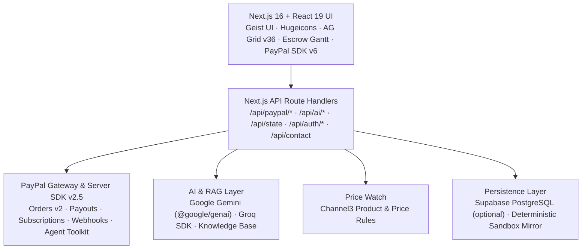

---

## Integrations & Tech Stack

| Layer / Integration | Package / Component | Responsibility |
| :--- | :--- | :--- |
| **Framework** | `next@16.3.6`, `react@19.2.8` | App Router UI, SSR/static routes, secure API handlers & CSP headers (`next.config.ts`) |
| **PayPal Commerce** | `@paypal/react-paypal-js`, `@paypal/paypal-server-sdk`, `@paypal/agent-toolkit` | Official PayPal / Pay Later / Venmo buttons, Orders v2 capture & `AUTHORIZE` holds, Payouts, Subscriptions, Invoices, Trackers, and signed Webhook checks |
| **Data Grid** | `ag-grid-community@^36.3.0`, `ag-grid-react@^36.3.0` | Light `themeQuartz` transaction ledger with pinned ID & amount columns, column visibility menu, unified filter bar, and CSV export |
| **Milestone Timeline** | [`BryntumEscrowTimeline.tsx`](NexusPulse/src/components/sponsors/BryntumEscrowTimeline.tsx) | Interactive status-coded schedule Gantt with date-range editing and Orders v2 capture controls |
| **Iconography** | `@hugeicons/react@^1.1.10`, `@hugeicons/core-free-icons@^4.4.0` | Consistent stroke-rounded icons wrapped via [`Icon.tsx`](NexusPulse/src/components/ui/Icon.tsx) |
| **AI & RAG** | `@google/genai@^3.0.0`, `groq-sdk@^1.6.0` | Spending reviews, image/checklist verification, TTS voice briefings, and Groq-powered RAG workspace assistant |
| **Database** | `@supabase/supabase-js@^2.119.0`, `pg@^8.23.1` | Optional PostgreSQL persistence (`src/lib/db/schema.sql`) with transparent mirror fallback |
| **Deployment** | [`NexusPulse/vercel.json`](NexusPulse/vercel.json), [`render.yaml`](render.yaml) | Vercel production hosting + daily AI cron, plus Render web service + 15-minute autonomous sweep worker |

---

## Workspace Engines & Routes

| Route | View / Purpose | Key Files |
| :--- | :--- | :--- |
| `/` | Overview, KPI strip & Spending Review panel | [`NexusPulse/src/app/page.tsx`](NexusPulse/src/app/page.tsx) |
| `/?tab=channel3#deal-hunter` | Price watch, target ceilings, PayPal v6 checkout & subscriptions | [`Channel3DealHunterPanel.tsx`](NexusPulse/src/components/sponsors/Channel3DealHunterPanel.tsx), [`PayPalV6CheckoutWidget.tsx`](NexusPulse/src/components/paypal/PayPalV6CheckoutWidget.tsx) |
| `/?tab=bounties#human-bounties` | Verified tasks board, upload proof & instant payouts | [`ProofOfHumanBountyBoard.tsx`](NexusPulse/src/components/bounties/ProofOfHumanBountyBoard.tsx) |
| `/?tab=bryntum#escrow-gantt` | Milestone escrow Gantt, holds, dates & capture | [`BryntumEscrowTimeline.tsx`](NexusPulse/src/components/sponsors/BryntumEscrowTimeline.tsx) |
| `/?tab=aggrid#telemetry` | AG Grid ledger, CSV export & webhook simulator | [`AgGridFinancialCommandCenter.tsx`](NexusPulse/src/components/sponsors/AgGridFinancialCommandCenter.tsx) |
| `/about` | Architecture overview, integrations, workflow guide & comparison | [`NexusPulse/src/app/about/page.tsx`](NexusPulse/src/app/about/page.tsx) |
| `/contact` | Validated contact intake, FAQs, reviewer info & briefings | [`NexusPulse/src/app/contact/page.tsx`](NexusPulse/src/app/contact/page.tsx) |

### API Surface

| Namespace | Endpoints |
| :--- | :--- |
| **System & State** | `GET /api/health` · `GET\|POST /api/state` · `POST /api/media/upload` · `GET\|POST /api/contact` |
| **Auth & Personas** | `POST /api/auth/login` · `POST /api/auth/signup` · `GET /api/auth/session` |
| **PayPal Gateway** | `GET /api/paypal/client-token` · `GET\|POST /api/paypal/orders` · `POST /api/paypal/escrow` · `POST /api/paypal/subscriptions` · `GET\|POST /api/paypal/invoices` · `POST /api/paypal/sync` · `POST /api/paypal/webhooks` |
| **AI & Price Watch** | `POST /api/ai/interact` · `POST /api/ai/chatbot` · `POST /api/ai/verify-bounty` · `POST /api/ai/voice-briefing` · `POST /api/channel3/search` |

---

## Quick Start

### Prerequisites

- **Node.js** `>= 20` and **npm**
- *(Optional)* PayPal Developer Sandbox credentials, Gemini API key, Groq API key, and Supabase project (all omitted keys default gracefully to the deterministic sandbox mirror)

### Local Setup

```bash
cd NexusPulse
npm install
cp .env.example .env.local
npm run dev
```

Open [http://localhost:3000](http://localhost:3000).

### Verification Commands

Run inside `NexusPulse/`:

```bash
# TypeScript typecheck
npm run lint

# Automated unit, security & PayPal gateway integration suite (17 tests)
npm test

# Production build verification
npm run build
```

### Optional Supabase Schema Provisioning

If you configure `DIRECT_URL` or `DATABASE_URL` in `NexusPulse/.env.local`, apply the SQL schema via:

```bash
cd NexusPulse
node scripts/migrate-supabase.mjs
```

### Environment Variables

See [`NexusPulse/.env.example`](NexusPulse/.env.example) for the complete template. Key variables include:

| Variable | Required | Description |
| :--- | :--- | :--- |
| `PAYPAL_MODE` / `PAYPAL_ENVIRONMENT` | Optional | Execution mode (`auto`, `sandbox`, `mirror`, `live`) |
| `PAYPAL_CLIENT_ID` / `PAYPAL_CLIENT_SECRET` | Optional | Server-side PayPal REST OAuth credentials |
| `NEXT_PUBLIC_PAYPAL_CLIENT_ID` | Optional | Public PayPal JS SDK v6 client ID for frontend checkout buttons |
| `PAYPAL_WEBHOOK_ID` | Optional | PayPal webhook ID used by `/api/paypal/webhooks` signature verification |
| `GEMINI_API_KEY` | Optional | Google Gemini API key for spending review, vision audit & TTS briefing |
| `GROQ_API_KEY` | Optional | Server Groq API key for `NexusAiChatbot` (can also be supplied via client BYOK) |
| `NEXT_PUBLIC_SUPABASE_URL` / `SUPABASE_SECRET_KEY` | Optional | Supabase project URL and secret/publishable key |
| `CHANNEL3_API_KEY` | Optional | Channel3 product search API key |

> **Pre-configured Sandbox Slot `013` Test Identities (non-secret placeholders in `.env.example`):**
> - Buyer: `sb-ifqau51324237@personal.example.com` (`AEME4VE2LQ8D8`)
> - Merchant: `sb-mokyu51324247@business.example.com` (`6NGH9RSQMDEUJ`)

---

## Repository Structure

```text
.
├── .github/
│   ├── ISSUE_TEMPLATE/
│   │   ├── bug_report.md
│   │   ├── config.yml
│   │   └── feature_request.md
│   ├── workflows/
│   │   └── ci.yml                       # GitHub Actions CI: lint, 17-test suite & build
│   └── pull_request_template.md
├── HD_Screenshots/                      # Verified 2160x1215 desktop & responsive captures
├── Top10_Submission_Screenshots/        # Top 10 curated workspace captures + CAPTIONS.md
├── render.yaml                          # Render Web Service + 15-min Cron Worker blueprint
├── README.md
└── NexusPulse/
    ├── package.json
    ├── next.config.ts                   # Strict CSP, COOP, HSTS & framing headers
    ├── vercel.json                      # Vercel config + daily /api/ai/interact cron
    ├── public/
    │   └── logo.svg                     # NexusPulse connected-node monogram
    ├── scripts/
    │   ├── autonomous-sweep.mjs         # Cron job script (render.yaml)
    │   ├── migrate-supabase.mjs         # Idempotent SQL schema runner
    │   ├── test-200-chatbot-queries.mjs # RAG chatbot verification script
    │   └── capture-*.mjs                # Screenshot & Devpost gallery generators
    └── src/
        ├── app/
        │   ├── tokens.css               # Single source of design tokens (Zinc, Indigo, Geist)
        │   ├── globals.css              # Base styles & 8s intro splash keyframes
        │   ├── icon.svg                 # App favicon matching NexusPulseMark
        │   ├── layout.tsx               # Geist fonts & BrandIntroSplash mount
        │   ├── page.tsx                 # Main workspace & Overview
        │   ├── about/                   # Architecture & integration details route
        │   ├── contact/                 # Support form, FAQ & briefings route
        │   └── api/                     # PayPal, AI/RAG, Auth, State, Contact & Health routes
        ├── components/
        │   ├── ai/                      # Executive briefing output
        │   ├── auth/                    # Auth modal & landing auth card
        │   ├── bounties/                # Proof-of-human task board
        │   ├── brand/                   # NexusPulseLogo & 8s BrandIntroSplash
        │   ├── chat/                    # NexusAiChatbot floating Groq RAG drawer
        │   ├── common/                  # Toast notifications
        │   ├── home/                    # Flow simulator, persona banner & comparison table
        │   ├── layout/                  # NexusHeader (profile switcher), FeaturePageHeader, Footer
        │   ├── paypal/                  # Official PayPal SDK v6 checkout widget
        │   ├── sponsors/                # AG Grid ledger, Escrow Gantt, Channel3 Deal Hunter
        │   └── ui/                      # Button, ConfirmDialog, FormField, Icon, ListSection, Skeleton, StatusDot
        ├── lib/
        │   ├── format.ts                # Intl USD formatting, short dates & humanized enum maps
        │   ├── ai/                      # Gemini agent & RAG knowledge base
        │   ├── auth/                    # 4 demo evaluator accounts & types
        │   ├── db/                      # schema.sql & Supabase client
        │   ├── paypal/                  # Server client, gateway, mirror state & types
        │   └── security/                # Input validation & origin checks
        └── tests/
            ├── nexus-pulse.test.ts      # 17 unit/integration/security tests
            └── chatbot-200-questions.test.ts
```

---

## Screenshots

### Workspace Overview & Controls

| Overview & KPIs | Workspace & Sandbox Mode Switcher |
| :---: | :---: |
| 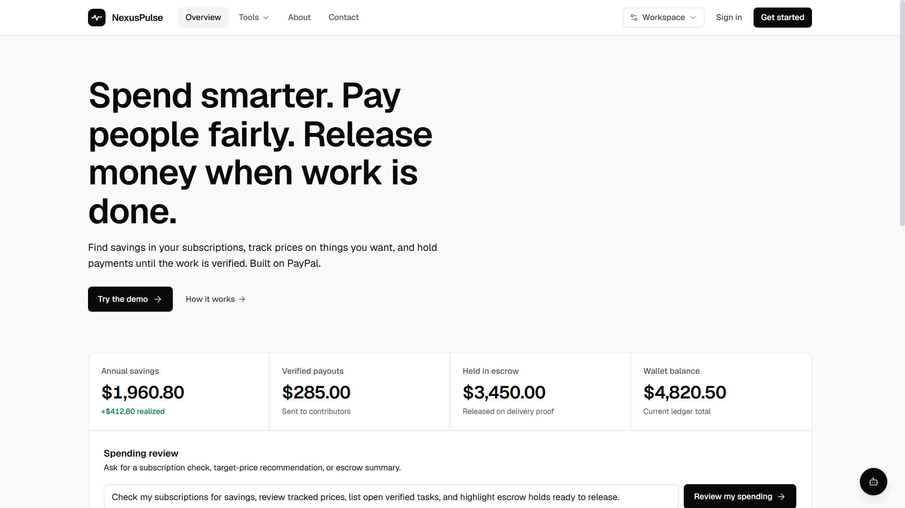<br/>*Hero, live KPI metrics, and Spending Review command bar* | 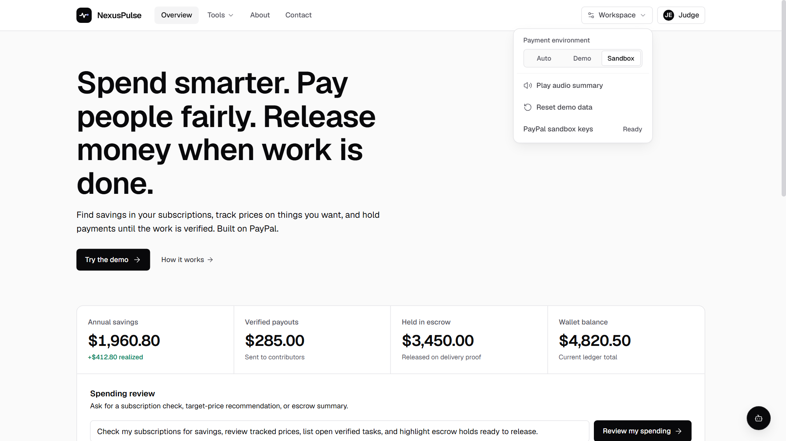<br/>*Auto / Demo / Sandbox environment toggle, audio summary & state reset* |

| Multi-Role Persona Sign-In | AI Spending Review |
| :---: | :---: |
| 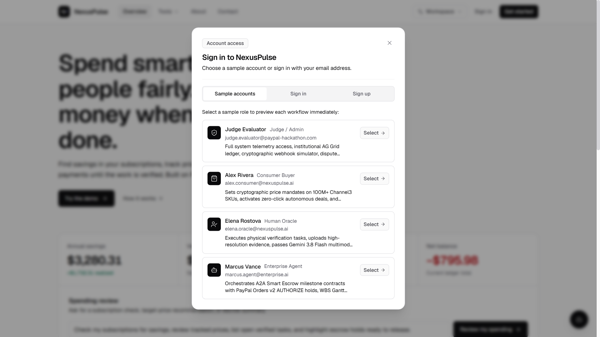<br/>*One-click demo personas (Judge, Consumer, Oracle, Enterprise) & sign-in* | 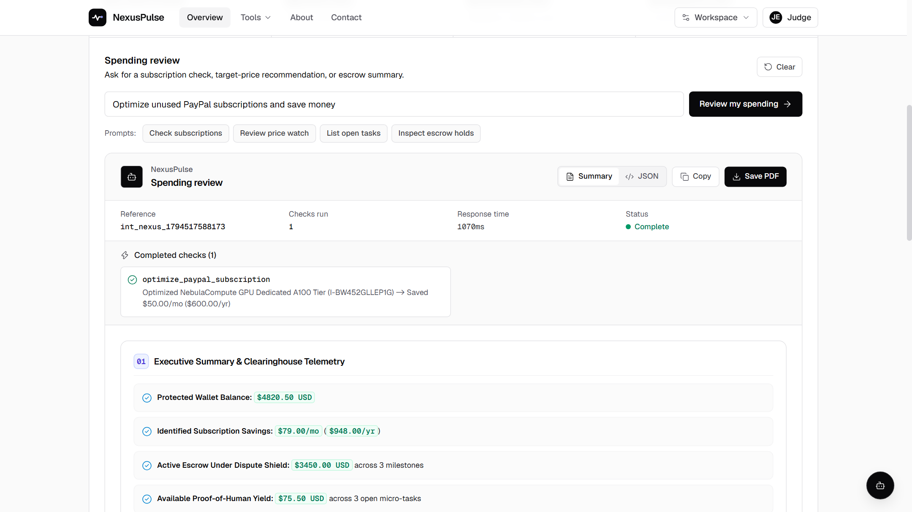<br/>*Structured spending analysis with Summary, JSON & PDF exports* |

### Core Engines, Ledger & Workspace Views

| Price Watch & PayPal Checkout | Verified Tasks & Instant Payouts |
| :---: | :---: |
| 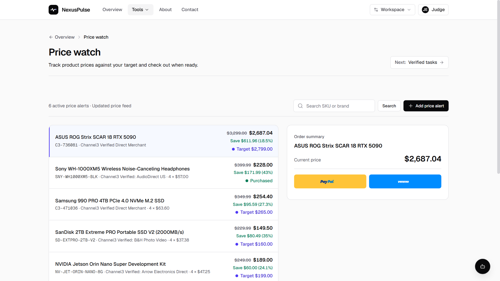<br/>*Target-price rules with official PayPal, Pay Later & Venmo checkout buttons* | 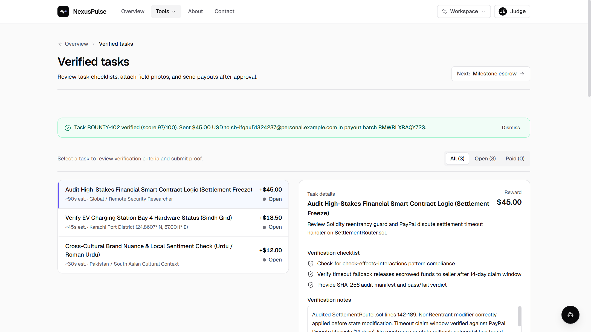<br/>*Task verification checklists, receipt scoring & instant PayPal Payouts* |

| Milestone Escrow Gantt | Subscription Downgrade Guard |
| :---: | :---: |
| 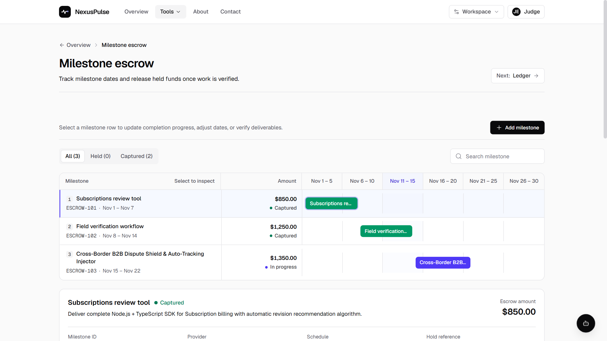<br/>*Status-coded schedule timeline & Orders v2 AUTHORIZE holds* | 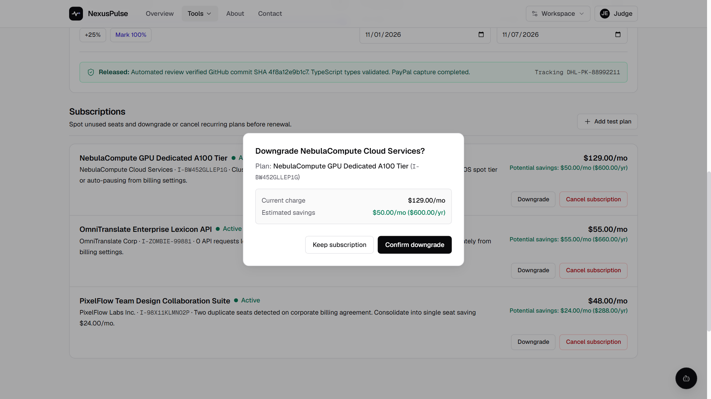<br/>*Tracking verification & explicit savings confirmation modal* |

| AG Grid Transaction Ledger | Live PayPal Invoicing v2 |
| :---: | :---: |
| 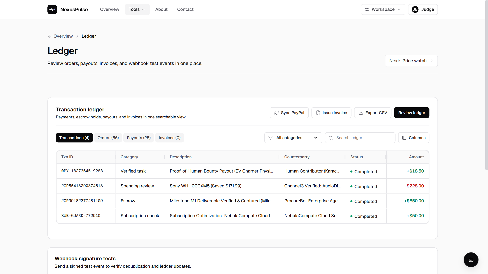<br/>*Pinned ID & amount columns, category filters, column picker & CSV export* | 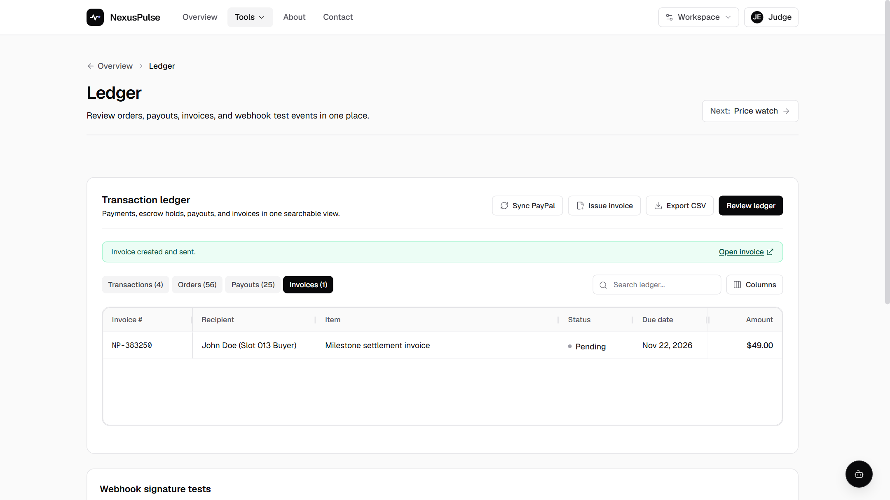<br/>*Direct PayPal Invoicing v2 creation and tracking inside the ledger* |

| Floating RAG Workspace Assistant | About & Support Views |
| :---: | :---: |
| 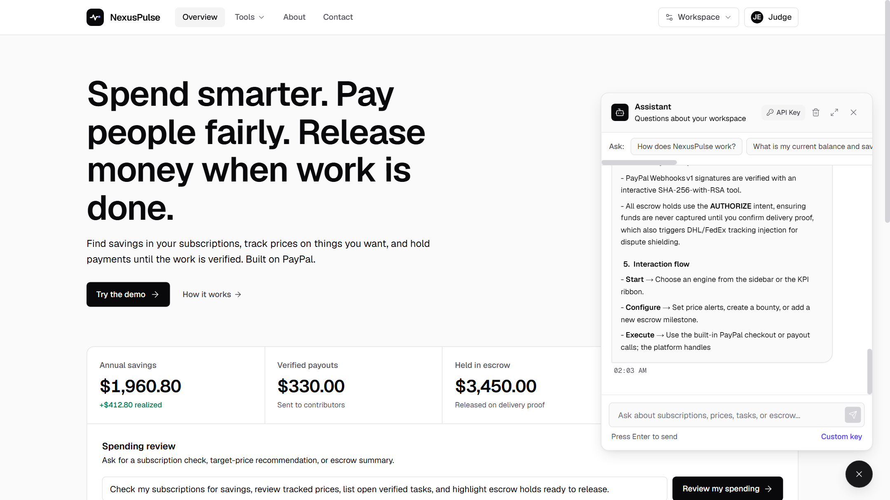<br/>*Groq RAG drawer with suggested prompts & custom BYOK API key support* | 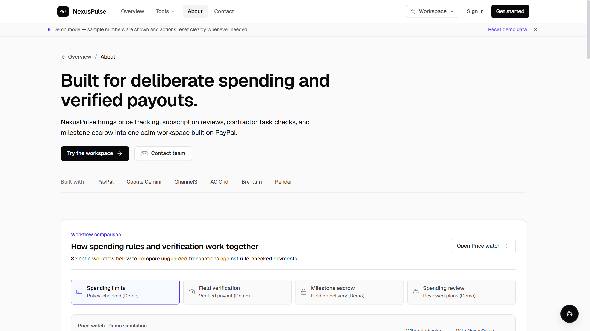<br/>*Architecture overview, workflow comparison tabs & integration details* |

Browse full-resolution captions in [`Top10_Submission_Screenshots/CAPTIONS.md`](Top10_Submission_Screenshots/CAPTIONS.md) and [`HD_Screenshots/CAPTIONS.md`](HD_Screenshots/CAPTIONS.md).

---

## Deployment

- **Vercel**: [`NexusPulse/vercel.json`](NexusPulse/vercel.json) sets the Next.js framework preset and schedules a daily check against `/api/ai/interact`. Set the root directory to `NexusPulse` in Vercel project settings.
- **Render**: [`render.yaml`](render.yaml) defines the `nexus-pulse-web` web service (`rootDir: NexusPulse`, health check `/api/health`) alongside the `nexus-pulse-autonomous-cfo-sweeper` cron job (`*/15 * * * *`, running `node scripts/autonomous-sweep.mjs`).
